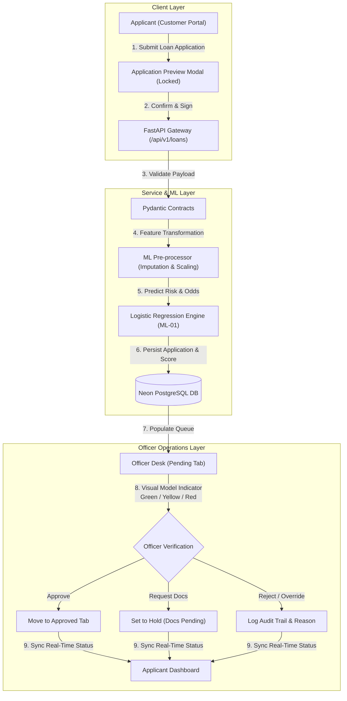

# Credora

<p align="center">
  <strong>Intelligent, Automated SaaS Credit Underwriting & Pre-Screening Platform</strong>
</p>

<p align="center">
  
  
  
  
  
  
  
</p>

---

### 🌐 Live Environments & Portals
- **Production Web Application**: [https://credora-fintech.web.app](https://credora-fintech.web.app/)
- **Interactive Documentation**: [https://team-antimatr.github.io/Credora](https://team-antimatr.github.io/Credora)
- **API Documentation**: Available locally at `/api/v1/docs` (Swagger UI) and `/api/v1/redoc` (ReDoc)

---

## 📌 1. Overview & Vision

**Credora** is an open-source, enterprise-grade credit underwriting and automated loan pre-screening platform. Built specifically to tackle credit assessment for retail and home loan applicants across urban, semi-urban, and rural demographics, Credora bridges automated machine learning scoring with mandatory human-in-the-loop regulatory verification.

### Core Value Pillars
1. **Explainable ML Pre-Screening**: Real-time loan risk evaluation using trained classification models with odds-ratio feature impacts and confidence scoring.
2. **Dual-Role Operations Portal**: Segregated workflows for Applicants (self-service tracking) and Credit Officers (underwriting queues, document verification, manual overrides).
3. **Immutable Review Guarantees**: Read-only application preview models ensuring submissions cannot be altered post-confirmation by either party.
4. **Institutional UX Standards**: Clean, accessible design system based on **Google Sans Flex**, free from distracting AI gimmicks, terminal noise, or generic button treatments.

---

## 🚀 2. Key Features

### 👤 Applicant Experience
- **Interactive Eligibility & Self-Service**: Direct loan product selection (Home Loan, Personal Loan, Auto Loan, SME Credit) with instant parameter calculators.
- **Smart Loan Application Flow**: Multi-step form capturing demographics, financial parameters, property types, and underwriting attributes with real-time validation.
- **Immutable Application Preview**: Comprehensive, uneditable pre-submission summary displaying verified KYC status, applicant demographics, and underwriting parameters.
- **Consolidated Dashboard**: Single-pane application status tracker (`Pending Review`, `Pre-Approved`, `On Hold (Docs Pending)`, `Approved`, `Denied`).

### 🛡️ Officer & Admin Operations Desk
- **Consolidated 4-Tab Operations Command Center**:
  - **Pending Applications**: Unprocessed applications with real-time model predictions and color-coded risk indicators:
    - 🟢 **Pre-Approved**: Low credit risk, compliant DTI.
    - 🟡 **On Hold**: Borderline metrics or pending KYC document verification.
    - 🔴 **Denied**: High credit risk, severe default probability.
  - **Approved Applications**: Final human-verified loans ready for disbursement.
  - **Total Users Activity**: Cross-role activity ledger tracking applicants, verification histories, and decision velocity.
  - **Model Statistics & Telemetry**: Live production model metrics including Accuracy, ROC-AUC, Precision, Recall, confusion matrices, and underwriting driver weights.
- **Human Verification & Override Controls**: Full officer authority to request additional documentation, overturn model pre-screen recommendations with audit reason logging, and issue final determinations.

---

## 🏗️ 3. System Architecture & Workflow



---

## 💻 4. Technology Stack

| Layer | Component | Description & Role |
| :--- | :--- | :--- |
| **Frontend UI** | HTML5, Tailwind CSS, Modular ES6 JS | Client-side responsive UI with custom Google Sans Flex typography |
| **State & Auth** | Firebase Authentication + Local Storage | Session tokens, role-based route guards (`applicant` vs `officer`) |
| **API Gateway** | Python 3.11+, FastAPI, Uvicorn | Asynchronous REST gateway with Pydantic v2 data transfer contracts |
| **Persistence** | PostgreSQL (Neon DB Serverless) | ACID-compliant relational storage with PgBouncer connection pooling |
| **ORM & Migrations** | SQLAlchemy 2.0 (Async) + Alembic | Declarative data models and schema revision control |
| **ML Engine** | scikit-learn, NumPy, Pandas, Joblib | Automated pre-screening classifier (Logistic Regression baseline) |
| **Hosting & CI/CD** | Firebase Hosting & Render | Static frontend CDN distribution and automated backend deployment |

---

## 📂 5. Repository Structure

```
Credora/
├── .github/
│   └── workflows/
│       └── deploy.yml              # CI/CD deployment automation
├── backend/
│   ├── alembic/                    # Database migration revisions
│   ├── app/
│   │   ├── api/v1/
│   │   │   ├── endpoints/
│   │   │   │   ├── auth.py         # Login, register, token refresh
│   │   │   │   ├── loans.py        # Loan submission & applicant queries
│   │   │   │   ├── admin.py        # Officer queue & decision overrides
│   │   │   │   ├── ml.py           # Model telemetry & feature weights
│   │   │   │   └── otp.py          # OTP phone verification endpoints
│   │   │   └── router.py           # API v1 endpoint registry
│   │   ├── core/
│   │   │   ├── config.py           # Pydantic Settings & environment variables
│   │   │   ├── database.py         # Neon PostgreSQL session factory
│   │   │   └── security.py         # JWT tokens & password hashing
│   │   ├── ml/                     # Backend model inference pipeline
│   │   │   ├── artifacts/          # Serialized production scaler & weights
│   │   │   └── models/             # Production .joblib estimators
│   │   ├── models/                 # SQLAlchemy relational ORM models
│   │   ├── schemas/                # Pydantic DTO validation contracts
│   │   ├── services/               # Application domain business logic
│   │   └── main.py                 # FastAPI application factory
│   ├── requirements.txt            # Python dependencies
│   └── .env.example                # Sample environment configuration
├── frontend/
│   ├── 403.html                    # Root 403 Restricted Access page
│   ├── 404.html                    # Root 404 Not Found page
│   ├── index.html                  # Public platform landing page
│   ├── pages/
│   │   ├── admin/
│   │   │   ├── admin.html          # Consolidated 4-tab Officer Portal
│   │   │   └── admin-login.html    # Staff authentication gateway
│   │   ├── app/
│   │   │   ├── apply-loan.html     # Loan application form & preview modal
│   │   │   ├── dashboard.html      # Applicant status & tracking dashboard
│   │   │   ├── loan-flow.html      # Multi-step loan workflow wizard
│   │   │   └── login.html          # Customer login & sign-up
│   │   ├── errors/                 # Standardized Figma error templates
│   │   │   ├── 403.html
│   │   │   └── 404.html
│   │   └── landing/                # Educational & public pages
│   │       ├── about.html
│   │       └── eligibility.html
│   └── public/
│       └── assets/                 # Fonts, CSS, icons, images, core JS modules
├── ml/
│   ├── data/                       # Raw & processed loan datasets
│   ├── models/                     # Serialized training artifacts
│   ├── notebooks/                  # 01_logistic_regression.ipynb
│   ├── reports/                    # Confusion matrix & ROC-AUC curves
│   └── src/                        # Modular preprocess, train & evaluate scripts
├── docs/                           # Architecture & workflow documentation
├── firebase.json                   # Firebase Hosting configuration
└── README.md                       # Main platform documentation
```

---

## ⚡ 6. Quick Start & Local Setup

### Prerequisites
- **Python**: `3.11+`
- **Node.js**: `v18+` (optional, for Firebase CLI or local HTTP servers)
- **PostgreSQL**: Neon DB connection string or local PostgreSQL 15+

### 1. Clone the Repository
```bash
git clone https://github.com/Team-Antimatr/Credora.git
cd Credora
```

### 2. Backend Setup
```bash
# Navigate to backend directory
cd backend

# Create and activate virtual environment
python -m venv venv
# On Windows:
.\venv\Scripts\activate
# On Linux/macOS:
source venv/bin/activate

# Install dependencies
pip install -r requirements.txt

# Configure environment variables
cp .env.example .env
# Edit .env with your DATABASE_URL, SECRET_KEY, and Firebase credentials

# Start development server
uvicorn app.main:app --reload --port 8000
```
API docs will be available at: `http://localhost:8000/api/v1/docs`

### 3. Machine Learning Pipeline Execution
To retrain or benchmark the pre-screening classifier:
```bash
# Clean data and generate encoded features
python ml/src/preprocess.py

# Train regularized Logistic Regression model
python ml/src/train.py

# Evaluate test performance and generate visual reports
python ml/src/evaluate.py
```

### 4. Frontend Setup
The frontend is built with modular ES6 modules and requires a local HTTP server:
```bash
# Option A: Python simple server from repository root
python -m http.server 5000

# Option B: Firebase CLI local emulation
firebase serve --only hosting
```
Open `http://localhost:5000/frontend/index.html` (or `http://localhost:5000/` if serving inside `frontend`).

---

## 📊 7. Machine Learning Baseline (ML-01 Performance)

The baseline model utilizes an **L2-regularized Logistic Regression classifier** with median/mode imputation and standard feature scaling trained on $N = 1,000$ verified banking records (80/20 stratified split).

| Metric | Target | Achieved | Operational Significance |
| :--- | :---: | :---: | :--- |
| **ROC-AUC Score** | $\ge 0.82$ | **0.9190** | High separability between creditworthy and delinquent applicants |
| **Accuracy** | Baseline | **86.84%** | 165 out of 190 unseen test applications classified accurately |
| **Precision (Approved)** | $\ge 0.75$ | **81.82%** | Minimizes False Positives (only 10 bad debts allowed out of 55 approvals) |
| **Recall (Approved)** | $\ge 0.70$ | **75.00%** | Captures 75% of all qualified prime borrowers |
| **F1-Score (Approved)** | $\ge 0.75$ | **78.26%** | Balanced risk-adjusted underwriting score |

### Confusion Matrix ($N = 190$ Test Set)
- **True Negatives (TN)**: `120` (High-risk applicants correctly identified and flagged)
- **False Positives (FP)**: `10` (Low default exposure)
- **False Negatives (FN)**: `15` (Subject to human officer review & secondary verification)
- **True Positives (TP)**: `45` (Automated pre-approval qualified)

---

## 🔒 8. Security & Access Control

- **Role-Based Guards**: Protected pages (`admin.html`) require verified officer roles and redirect unauthorized visitors to the standardized `403 Restricted Access` view.
- **Route Normalization**: Intelligent path-aware session persistence ensures post-login redirects land directly on destination dashboards without broken pathing or 404s.
- **Audit Logging**: Every credit officer decision (approval, document hold, rejection, or ML override) is immutably timestamped and recorded with reviewer identity.

---

## 👥 9. Contributing & License

Contributions, feedback, and issue submissions are welcomed! Please follow these steps:
1. Fork the Project.
2. Create your Feature Branch (`git checkout -b feat/AmazingFeature`).
3. Commit your Changes (`git commit -m 'feat: Add some AmazingFeature'`).
4. Push to the Branch (`git push origin feat/AmazingFeature`).
5. Open a Pull Request.

Distributed under the **MIT License**. See `LICENSE` for more details.

---

<p align="center">
  Developed with ❤️ by <strong>Team Antimatr</strong> • Credora Open Source FinTech Initiative
</p>