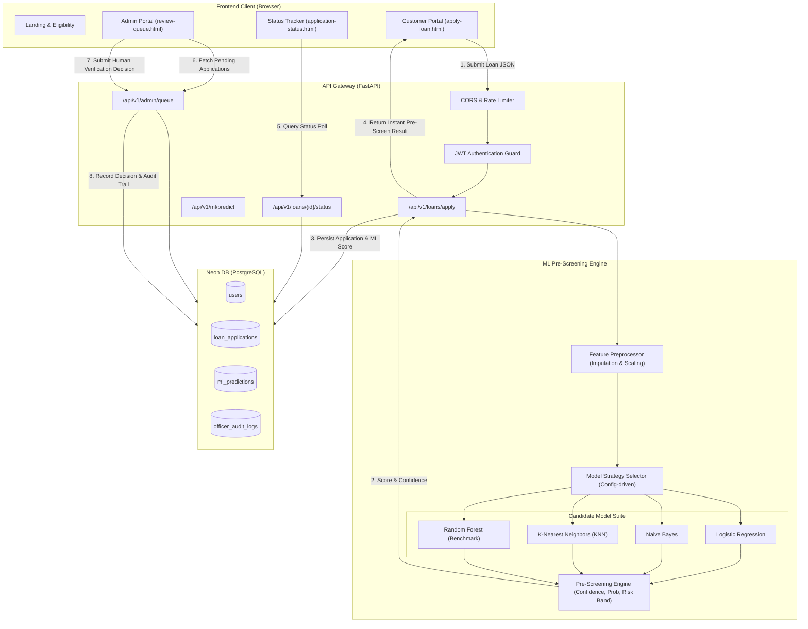
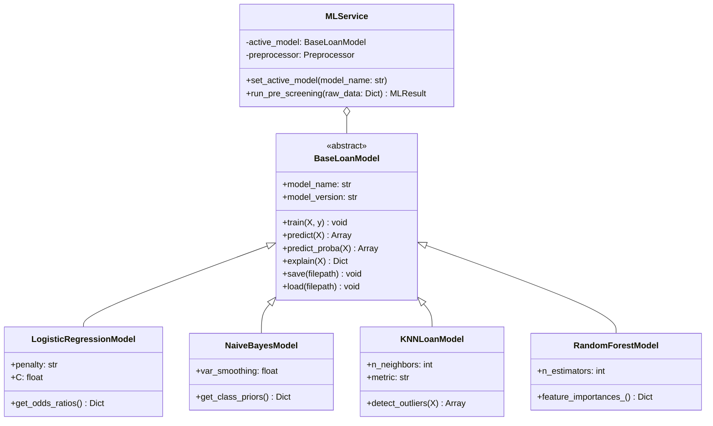

# Credora System Architecture (Architecture.md)

## 1. Executive Summary & Technology Stack

Credora is an **Intelligent Loan Approval System** engineered to automate and optimize credit evaluation for personal and home loans across urban and rural India. The platform combines a responsive client frontend, a high-throughput asynchronous REST API gateway, a modular machine learning pre-screening engine, and an auditable relational persistence layer.

### Technology Stack Overview

| Layer | Technology | Specification & Role |
| :--- | :--- | :--- |
| **Frontend UI** | HTML5, Tailwind CSS, Vanilla JS (ES6+) | 3-tier presentation: Public Landing, Applicant Portal, Loan Officer Admin Portal |
| **API Gateway** | Python 3.11+, FastAPI / Uvicorn | Asynchronous RESTful API with strict Pydantic v2 schemas and CORS control |
| **Machine Learning Engine** | Scikit-learn, NumPy, Pandas, Joblib | Modular Supervised Classification Pipeline supporting Logistic Regression, Naive Bayes, K-Nearest Neighbors (KNN), and Random Forest |
| **Relational Database** | PostgreSQL on Neon DB | Serverless PostgreSQL with PgBouncer connection pooling and SSL mode mandatory |
| **ORM & Migrations** | SQLAlchemy 2.0 (Async) + Alembic | Declarative data modeling and version-controlled database schema migrations |
| **Authentication & RBAC** | JWT (JSON Web Tokens) + Argon2 / Passlib | Role-Based Access Control distinguishing `Applicant` from `LoanOfficer` / `Admin` |
| **Deployment & Hosting** | Render / Vercel / Cloud Engine | Containerized backend web service and static CDN hosting for frontend assets |

---

## 2. Global Directory Architecture

```
Credora/
├── .github/
│   └── workflows/
│       └── deploy.yml                  # CI/CD deployment automation
├── backend/
│   ├── alembic/                        # Database migration revisions
│   │   ├── versions/
│   │   └── env.py
│   ├── app/
│   │   ├── api/
│   │   │   └── v1/
│   │   │       ├── endpoints/
│   │   │       │   ├── auth.py         # Login, register, token refresh, RBAC
│   │   │       │   ├── loans.py        # Loan application submission & customer queries
│   │   │       │   ├── admin.py        # Human officer verification queue & decision overrides
│   │   │       │   └── ml.py           # Model telemetry, pre-screening, & fairness metrics
│   │   │       └── router.py           # Main v1 endpoint registry
│   │   ├── core/
│   │   │   ├── config.py               # Pydantic Settings & environment variables
│   │   │   ├── database.py             # Neon DB connection & session factory
│   │   │   └── security.py             # JWT generation, token verification, password hashing
│   │   ├── ml/                         # Modular Machine Learning Subsystem
│   │   │   ├── artifacts/              # Serialized model weights (.joblib, .pkl)
│   │   │   │   └── model_registry.json # Active model version metadata
│   │   │   ├── models/
│   │   │   │   ├── base.py             # Abstract Base Estimator interface (Strategy Pattern)
│   │   │   │   ├── logistic_regression.py # Logistic Regression classifier
│   │   │   │   ├── naive_bayes.py      # Gaussian / Multinomial Naive Bayes classifier
│   │   │   │   ├── knn_model.py        # K-Nearest Neighbors (Classification & Outlier Detection)
│   │   │   │   └── random_forest.py    # Benchmark Ensemble model
│   │   │   ├── preprocessor.py         # OneHotEncoding, Imputation, MinMax/StandardScaler
│   │   │   └── evaluator.py            # Bias audit, confusion matrix, ROC-AUC calculations
│   │   ├── models/                     # SQLAlchemy Relational Models
│   │   │   ├── user.py                 # Users, credentials, roles (Applicant vs Officer)
│   │   │   ├── loan_application.py     # Loan details, applicant demographics, financials
│   │   │   ├── ml_prediction.py        # ML pre-screening scores, probabilities, model version
│   │   │   └── audit_log.py            # Officer approval/rejection audit trail
│   │   ├── schemas/                    # Pydantic DTOs & Validation Contracts
│   │   │   ├── auth.py                 # User credentials, JWT token response
│   │   │   ├── loan.py                 # Application input payload & status response
│   │   │   ├── ml.py                   # Prediction requests, confidence scores, feature weights
│   │   │   └── admin.py                # Queue filters, officer decision payload
│   │   ├── services/                   # Application Domain Business Logic
│   │   │   ├── auth_service.py         # Authentication & token management logic
│   │   │   ├── loan_service.py         # Loan submission, retrieval, and status transitions
│   │   │   ├── ml_service.py           # Preprocessing orchestration & model inference
│   │   │   └── queue_service.py        # Admin queue prioritization & override operations
│   │   └── main.py                     # FastAPI application factory & middleware setup
│   ├── tests/                          # Pytest suite (Unit, Integration, & ML benchmarks)
│   │   ├── test_auth.py
│   │   ├── test_loans.py
│   │   └── test_ml_pipeline.py
│   ├── alembic.ini
│   ├── requirements.txt
│   └── render.yaml
├── frontend/
│   ├── pages/
│   │   ├── admin/
│   │   │   ├── overview.html           # Operations dashboard & approval rates
│   │   │   ├── review-queue.html       # Final verification queue & decision modal
│   │   │   └── model-analytics.html    # Model card, fairness metrics & feature weights
│   │   ├── app/
│   │   │   ├── login.html              # Customer login & sign-up
│   │   │   ├── dashboard.html          # Customer applications overview
│   │   │   ├── apply-loan.html         # Multi-step loan application form
│   │   │   └── application-status.html # Real-time ML pre-screening outcome & timeline
│   │   └── landing/
│   │       ├── about.html              # Organization & ML transparency documentation
│   │       └── eligibility.html        # Criteria tables & KYC document checklist
│   ├── public/
│   │   └── assets/
│   │       ├── css/
│   │       │   ├── input.css           # Tailwind source directives
│   │       │   └── tailwind.css        # Production compiled stylesheet
│   │       ├── images/
│   │       │   ├── icons/
│   │       │   ├── landing/
│   │       │   └── logo/
│   │       └── js/
│   │           ├── admin/
│   │           │   ├── queue_manager.js# Officer verification & action handlers
│   │           │   └── charts.js       # Analytics rendering
│   │           ├── app/
│   │           │   ├── loan_form.js    # Multi-step form validation & payload builder
│   │           │   └── status_tracker.js # Real-time status polling & telemetry rendering
│   │           └── core/
│   │               ├── api_client.js   # Fetch wrapper, JWT bearer injection, error toast
│   │               ├── auth.js         # Session storage & role guards (Applicant vs Admin)
│   │               └── app.js          # Shared navbar, modals, and notification helpers
│   ├── index.html                      # Main entry landing page (Marketing & EMI calculator)
│   └── tailwind.config.js
├── docs/
│   ├── Architecture.md                 # Complete system architecture (This document)
│   ├── Workflow.md                     # End-to-end operational & data transfer workflow
│   ├── Phases.md                       # Project execution roadmap & milestones
│   └── PRD.md                          # Product requirements & business specifications
├── index.html                          # Root GitBook/Firebase style documentation portal
├── README.md
├── LICENSE
└── .gitignore
```

---

## 3. End-to-End Component Data Flow



---

## 4. Swappable Supervised ML Model Architecture (Strategy Pattern)

To allow flexible experimentation across **Logistic Regression**, **Naive Bayes**, **K-Nearest Neighbors (KNN)**, and **Random Forest** (all trained on labeled historical loan datasets with target `Loan_Status`), the ML subsystem implements an object-oriented Strategy Pattern.



### Supported Model Variants:
1. **Logistic Regression (`logistic_regression.py`)**:
   - Supervised linear probabilistic model providing transparent odds ratios.
   - High interpretability for credit compliance and feature contribution reporting.
2. **Naive Bayes (`naive_bayes.py`)**:
   - Probabilistic baseline classifier using Gaussian/Multinomial formulation.
   - Exceptionally fast inference (< 5ms) suitable for high-frequency intake.
3. **K-Nearest Neighbors (`knn_model.py`)**:
   - Instance-based classification matching new applicants to nearest historical cohorts.
   - Unsupervised outlier / distance scoring to detect atypical applicant profiles.
4. **Random Forest (`random_forest.py`)**:
   - Production benchmark ensemble model achieving 86.4%+ validation accuracy with non-linear feature interactions.

---

## 5. Security & Governance

1. **Data Confidentiality**:
   - SSL mode mandatory (`sslmode=require`) for all Neon DB pooler connections.
   - Sensitive applicant data (identity numbers, income proofs) encrypted at rest and masked in logs.
2. **Role-Based Access Control (RBAC)**:
   - `Applicant`: Access restricted exclusively to personal applications and status tracking.
   - `LoanOfficer`: Access to review queue, applicant details, ML telemetry, and decision override actions.
   - `Admin`: Full access including model performance analytics, fairness audits, and user management.
3. **Model Fairness & Bias Auditing**:
   - Continuous parity assessment across demographic features (Gender, Marital Status, Urban vs Rural Property Area) to ensure zero discrimination in pre-screening outputs.
