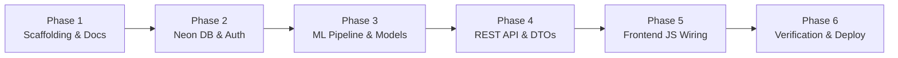

# Credora Development Roadmap & Execution Phases (Phases.md)

## Phase Roadmap Overview

---

## Phase 1: Architecture & Scaffolding
- [x] Analyze existing documentation, issue #1, and frontend mockups.
- [x] Scaffold 3-tier frontend directory structure (`landing/`, `app/`, `admin/`, `assets/`).
- [x] Establish comprehensive system architecture (`docs/Architecture.md`).
- [x] Formalize end-to-end API and ML pre-screening workflows (`docs/Workflow.md`).
- [ ] Scaffold `backend/` directory structure with modular ML layer.

---

## Phase 2: Relational Database & Authentication
- [ ] **Neon DB Provisioning**: Configure serverless PostgreSQL instance with SSL pooled connection.
- [ ] **Data Modeling**:
  - `users`: `id`, `email`, `hashed_password`, `role` (`applicant`, `officer`, `admin`).
  - `loan_applications`: Demographics, income, loan amount, term, property area, credit history, status.
  - `ml_predictions`: Confidence score, probability, risk band, model name/version, inference timestamp.
  - `officer_audit_logs`: Application ID, officer ID, action (approve/reject), override reason, timestamp.
- [ ] **Alembic Setup**: Initialize migration environment and run initial database migration.
- [ ] **Security Engine**: JWT authentication, password hashing with Argon2, and role guard middlewares.

---

## Phase 3: Machine Learning Engine (Swappable Strategy Architecture)
- [ ] **Data Ingestion & Benchmark Pipeline**:
  - Load and clean historical Kaggle benchmark loan dataset.
  - Implement imputation, log transforms, and OneHotEncoder / StandardScaler pipeline (`preprocessor.py`).
- [ ] **Model Implementations (`backend/app/ml/models/`)**:
  - `BaseLoanModel`: Abstract base interface defining `train`, `predict`, `predict_proba`, `explain`.
  - `LogisticRegressionModel`: Interpretable baseline with odds ratios.
  - `NaiveBayesModel`: High-speed Gaussian probabilistic classifier.
  - `KNNLoanModel`: Peer-group distance classifier and unsupervised outlier detector.
  - `RandomForestModel`: Production benchmark model (86.4%+ validation accuracy).
- [ ] **Model Evaluation & Fairness Suite**:
  - Automated bias audit across Gender, Marital Status, and Urban/Rural Property Area.
  - Model serialization to `ml/artifacts/` with version metadata.

---

## Phase 4: Asynchronous REST API Gateway
- [ ] **Applicant Endpoints**:
  - `POST /api/v1/loans/apply`: Validates loan submission, triggers ML inference, stores record, returns instant score.
  - `GET /api/v1/loans/{id}/status`: Provides real-time lifecycle timeline for tracking view.
  - `GET /api/v1/loans/my-applications`: Fetches applicant's active and previous loan applications.
- [ ] **Admin & Loan Officer Endpoints**:
  - `GET /api/v1/admin/queue`: Returns pending loans filtered by region, risk band, and ML recommendation.
  - `POST /api/v1/admin/loans/{id}/decision`: Records human verification decision (Approve/Reject) with notes.
  - `GET /api/v1/admin/analytics/overview`: Aggregates portfolio throughput, approval rates, and cycle times.
  - `GET /api/v1/admin/analytics/model-card`: Telemetry on model accuracy, feature importance, and fairness parity.

---

## Phase 5: Frontend Modular JavaScript Integration
- [ ] Clean injected browser extension styles from HTML files to optimize bundle size.
- [ ] Build `public/assets/js/core/api_client.js` with centralized `fetch` handling, JWT injection, and toast errors.
- [ ] Implement `public/assets/js/core/auth.js` with role protection and login state management.
- [ ] Implement `public/assets/js/app/loan_form.js` handling multi-step form progress and payload compilation.
- [ ] Implement `public/assets/js/app/status_tracker.js` querying `/status` and rendering progress milestones.
- [ ] Implement `public/assets/js/admin/queue_manager.js` for queue filtering and approve/reject modal actions.
- [ ] Implement `public/assets/js/admin/charts.js` for analytics graphs.

---

## Phase 6: Cloud Deployment & Monitoring
- [ ] Deploy FastAPI backend to Render / Cloud Engine with automated health check `/health`.
- [ ] Link Neon DB production pooler connection string.
- [ ] Host static frontend assets on CDN / Vercel / Render Static Site.
- [ ] Perform end-to-end integration testing (Applicant Submit -> ML Pre-screen -> Officer Decision -> Status Sync).
