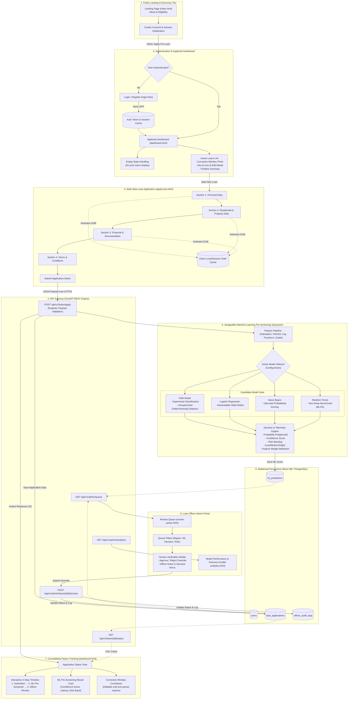

# Credora Comprehensive Workflow Architecture (Workflow.md)

## 1. Overall System Architecture & Workflow Diagram

This workflow integrates the applicant journey (from `credora.drawio`), the API Gateway layer, the modular Machine Learning Engine (supporting KNN, Logistic Regression, Naive Bayes, and Random Forest), the Neon DB persistence layer, and the Loan Officer Admin Verification portal.



---

## 2. Detailed Process Steps & Requirements

### 2.1 Landing & Cookie Consent
1. The user navigates to public views (`index.html`, `about.html`, `eligibility.html`).
2. A non-intrusive cookie consent banner informs the applicant about essential session cookies and storage for draft preservation.
3. Upon clicking **"Apply for Loan"**, an authentication guard checks for a valid JWT in `localStorage`.
   - If unauthenticated: user is routed to `login.html`.
   - If authenticated: user proceeds directly to `dashboard.html` or `apply-loan.html`.

### 2.2 Applicant Dashboard & Correction Window Feature
1. **Empty State**: If an applicant has never submitted an application, the dashboard renders a clean, friendly empty state with an invitation to start a new application.
2. **Active Loans Display**:
   - Each active application card displays the Application ID, requested loan amount, loan type (Home/Personal), and current stage.
   - **Correction Window & Info (`i`) Icon**: Each card includes an informational popover explaining the **24-hour correction window**. Within this window, applicants can click the **Edit** button to update non-financial errors (e.g., misspelled name, updated address proof) before officer lock-in.
   - **Timeline Indicator**: A compact horizontal progress bar shows:
     `Submitted` ➔ `ML Pre-Screened` ➔ `Under Officer Review` ➔ `Sanctioned/Rejected`.

### 2.3 Multi-Step Loan Application with Draft Caching
The application form (`apply-loan.html`) is structured into 4 sequential sections:
1. **Section 1: Personal Data**: Full Name, Gender, Marital Status, Dependents, Education.
2. **Section 2: Residential Data**: Current Address, Housing Type, Property Area (Urban, Semi-Urban, Rural).
3. **Section 3: Financial & Documentation**: Employment Type (Salaried/Self-Employed), Applicant Income, Coapplicant Income, Requested Loan Amount, Loan Term (Months), CIBIL / Existing Loan History, Collateral Description.
4. **Section 4: Terms & Conditions**: Transparency acknowledgement and consent for automated ML pre-screening.
* **Client-Side Draft Caching**: Every field change is autosaved into `sessionStorage` (`credora_loan_draft`), guaranteeing zero data loss if the applicant reloads or switches tabs.

---

## 3. Machine Learning Pre-Screening Engine (Swappable Architecture)

The ML engine is decoupled from the web layer via an **Abstract Base Estimator Strategy Pattern** (`backend/app/ml/models/base.py`). This allows selecting or comparing models dynamically:

### Candidate Model Comparison & Roles:

| Model Architecture | Type | Primary Function | Advantages in Credora |
| :--- | :--- | :--- | :--- |
| **K-Nearest Neighbors (KNN)** | Instance-based (Supervised & Unsupervised) | 1. Classification via majority neighbor voting.<br/>2. **Unsupervised Outlier Detection**: Measures Euclidean/Mahalanobis distance to historical applicant cohorts to detect unusual or potentially fraudulent profiles. | Identifies similar historical borrowers; intuitive clustering; flags anomalies without requiring explicit fraud labels. |
| **Logistic Regression** | Supervised Linear Classifier | Estimates approval probability using Sigmoid curve; generates exact odds-ratios. | Highest regulatory explainability; required by banking compliance standards for transparent rejection justifications. |
| **Naive Bayes** (Gaussian) | Supervised Probabilistic Classifier | Computes posterior probability using Bayes' Theorem with feature conditional independence. | Extremely lightweight inference (< 2ms); functions with minimal memory overhead in high-throughput peak application hours. |
| **Random Forest** (Benchmark) | Supervised Ensemble Classifier | Aggregates multiple decision trees with feature bagging. | Baseline champion achieving **86.4% validation accuracy**; handles non-linear interactions (e.g., income vs. loan amount ratio). |

### Preprocessing & Feature Pipeline:
* **Numerical Imputation & Transformation**:
  - `ApplicantIncome` & `LoanAmount`: Imputed via median, normalized with $\log(1 + x)$ to eliminate skewness.
  - `CoapplicantIncome`: Combined with applicant income to compute `TotalHouseholdIncome` and `DebtToIncomeRatio`.
  - `Loan_Amount_Term`: Standardized to standard deviations.
* **Categorical Encoding**:
  - `Gender`, `Married`, `Education`, `Self_Employed`: Binary mapped (`0` or `1`).
  - `Property_Area`: One-Hot Encoded into `Property_Area_Urban`, `Property_Area_Semiurban`, `Property_Area_Rural`.
  - `Credit_History`: Binary indicator (`1.0` = satisfactory history, `0.0` = past default).

---

## 4. API-Based Data Transfer Contracts

### 4.1 Application Submission Payload (`POST /api/v1/loans/apply`)
```json
{
  "personal": {
    "full_name": "Rahul Sharma",
    "gender": "Male",
    "married": "Yes",
    "dependents": "2",
    "education": "Graduate"
  },
  "residential": {
    "address": "Flat 402, Green Valley Apartments",
    "city": "Pune",
    "state": "Maharashtra",
    "property_area": "Urban"
  },
  "financial": {
    "self_employed": "No",
    "applicant_income": 58490.00,
    "coapplicant_income": 16000.00,
    "loan_amount": 2500000.00,
    "loan_term_months": 240,
    "credit_history": 1.0,
    "loan_type": "Home"
  },
  "terms_accepted": true
}
```

### 4.2 Application Submission Response (201 Created)
```json
{
  "success": true,
  "data": {
    "application_id": "CRD-2026-00025648",
    "tracking_number": "TRK-984210",
    "status": "UNDER_OFFICER_REVIEW",
    "submitted_at": "2026-11-19T10:30:00Z",
    "correction_window_expires_at": "2026-11-20T10:30:00Z",
    "ml_telemetry": {
      "model_name": "KNN-Classifier-v1.2",
      "pre_screening_outcome": "PRE_APPROVED",
      "confidence_score": 0.884,
      "risk_band": "LOW",
      "outlier_score": 0.042,
      "inference_time_ms": 3.8
    }
  }
}
```

### 4.3 Real-Time Status Query (`GET /api/v1/loans/{id}/status`)
```json
{
  "success": true,
  "data": {
    "application_id": "CRD-2026-00025648",
    "current_stage": "OFFICER_REVIEW",
    "correction_window_active": true,
    "remaining_correction_minutes": 1380,
    "stages": [
      { "id": 1, "title": "Application Submitted", "completed": true, "timestamp": "2026-11-19 10:30" },
      { "id": 2, "title": "ML Pre-Screening", "completed": true, "result": "PRE_APPROVED (88.4%)", "timestamp": "2026-11-19 10:30" },
      { "id": 3, "title": "Officer Verification", "completed": false, "desk": "Central Desk" },
      { "id": 4, "title": "Disbursal Sanction", "completed": false }
    ]
  }
}
```

### 4.4 Officer Decision Override (`POST /api/v1/admin/loans/{id}/decision`)
```json
{
  "action": "APPROVE",
  "ml_overridden": false,
  "officer_notes": "All KYC verified, CIBIL score verified above 750.",
  "sanctioned_amount": 2500000.00,
  "interest_rate": 8.5
}
```

---

## 5. Loan Officer Admin Portal Workflow
1. **Officer Login**: Officers log in using staff credentials, authenticated via JWT with the `role: officer` or `role: admin` claim.
2. **Overview Dashboard (`overview.html`)**: Summarizes daily application volume, approval distribution, average pre-screening cycle time (< 1s), and pending queue count.
3. **Review Queue (`review-queue.html`)**:
   - Filter by Region (Urban, Semi-Urban, Rural) and ML Prediction (Approved, Rejected, Edge Case).
   - Each queue card highlights applicant name, loan amount, CIBIL score, ML confidence badge, and outlier risk.
   - Clicking an application opens the verification drawer showing document proofs alongside the model's feature importance weights.
   - Officer executes **Approve** or **Reject** with mandatory notes, which immediately updates the applicant's status timeline.
4. **Model Analytics (`model-analytics.html`)**: Displays model validation curves, demographic fairness metrics (verifying equal opportunity across genders and regions), and feature contribution weights.
