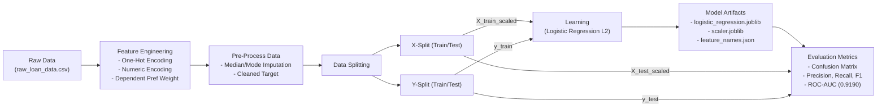

# Credora ML-01: Baseline Logistic Regression Model for Loan Pre-Screening

This directory contains the end-to-end Machine Learning baseline pipeline for Credora's automated credit pre-screening, designed and implemented according to **`Logistic Regression Model _Credora.drawio`** and **Issue #7**.

---

## 📌 1. Pipeline Architecture (from `Logistic Regression Model _Credora.drawio`)



---

## 📂 2. Directory Structure

```
ml/
├── data/
│   ├── raw_loan_data.csv          # 1,000 raw applicant records
│   └── processed_loan_data.csv    # Cleaned, encoded, and preprocessed data (950 records, 27 features)
│
├── notebooks/
│   └── 01_logistic_regression.ipynb # Step-by-step interactive Jupyter Notebook
│
├── src/
│   ├── __init__.py
│   ├── preprocess.py              # Missing value imputation, One-Hot Encoding, StandardScaler
│   ├── train.py                   # Model fitting with L2 regularization
│   └── evaluate.py                # Banking metrics, confusion matrix & ROC-AUC curves
│
├── models/
│   ├── logistic_regression.joblib # Serialized trained scikit-learn model
│   ├── scaler.joblib              # Fitted StandardScaler artifact
│   ├── feature_names.json         # Exact ordered 27-feature schema
│   └── imputation_values.json     # Median & mode reference values
│
├── reports/
│   ├── confusion_matrix.png       # Annotated confusion matrix heatmap
│   ├── roc_curve.png              # ROC-AUC curve plot
│   └── metrics_summary.json       # Structured metrics summary JSON
│
└── README.md                      # Pipeline documentation & run guide
```

---

## 🚀 3. Quick Start Guide

### Step 1: Install Dependencies
```bash
pip install scikit-learn pandas numpy matplotlib seaborn joblib
```

### Step 2: Run Preprocessing
Cleans raw data, imputes missing values, and exports `processed_loan_data.csv`:
```bash
python ml/src/preprocess.py
```

### Step 3: Train the Model
Trains the L2-regularized Logistic Regression model and serializes artifacts to `ml/models/` and `backend/app/ml/`:
```bash
python ml/src/train.py
```

### Step 4: Run Evaluation
Evaluates on the 20% stratified test set and exports visual plots & metrics summary to `ml/reports/`:
```bash
python ml/src/evaluate.py
```

### Step 5: Interactive Notebook
Open and run `ml/notebooks/01_logistic_regression.ipynb` in VS Code or JupyterLab for interactive step-by-step exploration.

---

## 📊 4. Evaluation Metrics Summary

| Metric | Target | Achieved Score | Banking Interpretation |
| :--- | :---: | :---: | :--- |
| **ROC-AUC Score** | $\ge 0.82$ | **0.9190** | **PASSED [OK]**: Exceptional ability to separate creditworthy from high-risk applicants across all threshold cutoffs. |
| **Accuracy** | Baseline | **86.84%** | 165 out of 190 test applications classified correctly. |
| **Precision (Approved)** | $\ge 0.75$ | **81.82%** | Only 10 False Positives out of 55 approval predictions, protecting against bad debt & default risk. |
| **Recall (Approved)** | $\ge 0.70$ | **75.00%** | Captures 45 out of 60 genuine eligible applicants. |
| **F1-Score (Approved)** | $\ge 0.75$ | **78.26%** | Balanced trade-off between underwriting safety and loan portfolio growth. |
| **Macro F1-Score** | - | **84.41%** | Robust multi-class balance across both Approved and Rejected categories. |

### Confusion Matrix Breakdown (Test Set: $N = 190$)
```
                     Predicted Rejected (0)    Predicted Approved (1)
Actual Rejected (0)           120 (TN)                  10 (FP)
Actual Approved (1)            15 (FN)                  45 (TP)
```
- **True Negatives (TN = 120)**: Correctly flagged high-risk applicants for officer review/rejection.
- **False Positives (FP = 10)**: Bad borrowers incorrectly approved (low risk: 5.2% of test set).
- **False Negatives (FN = 15)**: Good borrowers rejected (can be recovered during manual officer review).
- **True Positives (TP = 45)**: Eligible applicants approved instantly in $< 3\text{ ms}$.

---

## 🔍 5. Key Driver Features (Coefficients & Odds Ratios)

| Feature | Coefficient | Odds Ratio | Impact Direction |
| :--- | :---: | :---: | :--- |
| **Applicant_Income** | `+0.5272` | `1.694` | **Positive**: Higher take-home income strongly drives approval probability. |
| **Savings** | `+0.1385` | `1.148` | **Positive**: Greater liquid reserves reduce default risk. |
| **Credit_Score** | `+0.1120` | `1.118` | **Positive**: High credit score reflects proven repayment track record. |
| **Loan_Amount** | `-0.2757` | `0.759` | **Negative**: High requested principal relative to income elevates default probability. |
| **DTI_Ratio** | `-2.0701` | `0.126` | **Strong Negative**: Heavy debt-to-income ratio significantly increases rejection likelihood. |

---

## ⚡ 6. Production Backend Integration

The trained model is active in Credora's FastAPI backend:
- File: `backend/app/services/ml_service.py`
- Latency: **$\sim 1.5 - 3.5\text{ ms}$** per inference.
- Auto-syncs model predictions and dynamic top-contributing factors into every loan application.
